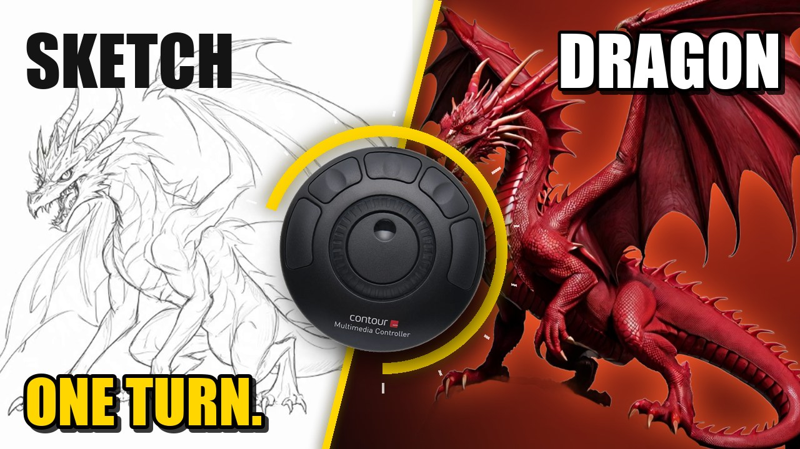
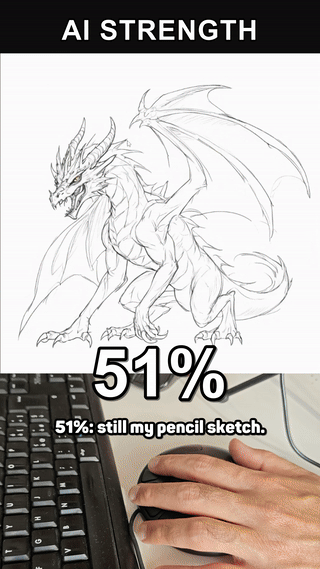

# Krita Dial

[](https://www.youtube.com/watch?v=mxHgwdUfWK4)

**I gave AI a physical knob.** Krita Dial is a free Krita plugin that turns the
[Contour xPress Multimedia Controller](https://cd.now/the-creattivo) into a hardware controller for
[Krita AI Diffusion](https://github.com/Acly/krita-ai-diffusion).



- **Outer ring**: turn and hold to change the strength (denoise), live, while Live Painting redraws.
- **Jog wheel**: scroll through your generated results, or through seeds in Live mode.
- **Buttons**: generate, apply, new seed, Live on/off, undo.

Every control can be remapped, and any button can trigger any Krita action.

**[Download the latest release](../../releases/latest)** · [Watch the video](https://www.youtube.com/watch?v=mxHgwdUfWK4) ·
[Installation](#installation) · [Default controls](#default-controls)

**Get the controller:** [Contour xPress Multimedia Controller](https://cd.now/the-creattivo),
15% off on the Contour shop with code `The-Creattivo`.

<br clear="right">

## Requirements

- **Windows 10 or 11.** Version 0.1 is Windows only.
- **Krita 5.2** or newer (tested with 5.2.9).
- **[Krita AI Diffusion](https://github.com/Acly/krita-ai-diffusion)**, installed and working (tested with 1.53.0).
  Without it, only buttons mapped to plain Krita actions do something.
- **Contour xPress Multimedia Controller** (USB ID `0B33:0020`). Other Contour devices are not supported yet.

No driver or extra Python package is needed: the plugin reads the device directly through Windows.

## Installation

1. Download `krita_dial-<version>.zip` from the [latest release](../../releases/latest). Do not unzip it.
2. In Krita: **Tools > Scripts > Import Python Plugin from File...**, pick the zip, and answer **Yes** to enable it.
3. Restart Krita.
4. Show the panel: **Settings > Dockers > Krita Dial**.

The **Controller** line in the panel should say `connected`. You can plug the device in before or after
starting Krita.

**Contour software:** close the Contour software while you use the plugin. If both are running, they may
both react to the device and each command can run twice.

### Update

Import the new zip the same way and restart Krita. Your mapping file is kept.

### Uninstall

With Krita closed, delete these from `%APPDATA%\krita\pykrita`:

- the `krita_dial` folder
- the `krita_dial.desktop` file

Optionally, delete `%APPDATA%\krita\krita_dial.json` (your mapping) and `%APPDATA%\krita\krita_dial.log`.

## Default controls

| Control | Action |
|---|---|
| Button 1 | Generate |
| Button 2 | Apply the selected result (in Live: apply the live result) |
| Button 3 | New random seed |
| Button 4 | Live Painting on/off (switches to the Live workspace) |
| Button 5 | Undo |
| Jog wheel | Previous / next result in the history |
| Jog wheel, Live workspace | Previous / next seed (turning past the newest makes a new one) |
| Outer ring | Strength down (left) / up (right); turn further to change it faster |

The strength goes to the active workspace: Generate, Live or Upscale.
Live Painting uses few sampling steps, so the strength changes the image in coarse steps there, and each new
image takes a moment to appear.

## The panel

The **Krita Dial** docker shows the device status, the AI Diffusion workspace, strength, seed, the selected
result and the last input received.

The **Simulator** box works like the device: use it to try the mapping without the controller.

**Reload mapping** reads your mapping file again. **Open folder** opens the folder that contains it.
Mapping errors appear in red at the bottom of the panel.

## Custom mapping

Create `%APPDATA%\krita\krita_dial.json` (use **Open folder** in the panel to find the folder).
Write only what you want to change: everything else keeps the default.
Then press **Reload mapping**.

Example: button 5 cancels the current generation, and in the Upscale workspace the jog wheel does nothing.

```json
{
  "version": 1,
  "default": {
    "buttons": {
      "5": {"action": "ai.cancel"}
    }
  },
  "workspaces": {
    "upscaling": {
      "jog": null
    }
  }
}
```

A binding is an object with an `"action"` key and its parameters, or `null` to do nothing.
The `"workspaces"` section overrides `"default"` only in that AI Diffusion workspace:
`generation`, `upscaling`, `live`, `animation` or `custom`.
The full default mapping is in [`krita_dial/default_mapping.json`](krita_dial/default_mapping.json).

### Actions

| Action | Use on | Parameters |
|---|---|---|
| `ai.generate` | button | |
| `ai.apply` | button | |
| `ai.cancel` | button | |
| `ai.new_seed` | button | |
| `ai.toggle_live` | button | |
| `ai.strength` | ring, jog | `step`: change per tick (default `0.01`, multiplied by the ring position). `repeat_ms`: on the ring, repeat every N ms while held |
| `ai.history` | jog | |
| `ai.seed_scroll` | jog | |
| `krita.action` | button | `name`: a Krita action name, e.g. `"edit_undo"`, `"edit_redo"`, `"view_zoom_in"` |

To list every Krita action name, run this in **Tools > Scripts > Scripter**:

```python
print(sorted(a.objectName() for a in Krita.instance().actions()))
```

## Troubleshooting

- **Controller: not connected**: check the USB cable, then unplug and plug the device back in.
  The plugin looks for it every 2 seconds.
- **AI Diffusion: not found**: install Krita AI Diffusion, open a document, then press **Reload mapping**.
- **Commands run twice**: close the Contour software (see [Installation](#installation)).
- Anything else: the log is in `%APPDATA%\krita\krita_dial.log`. Please attach it when you open an issue.

## Development

- `tools/dev_install.ps1` links the `krita_dial` folder into Krita's `pykrita` folder, so code changes
  apply after a Krita restart.
- `python -m unittest discover tests` runs the tests that do not need Krita.
- `python tools/build_release.py` builds the release zip in `dist/`.
- `docs/` has notes (in Italian) on the xPress HID reports and on the Krita AI Diffusion internals used.

The plugin uses internal parts of Krita AI Diffusion, which may change between versions.
If something breaks after an AI Diffusion update, please open an issue with both version numbers.

## Credits

Made by Edo Santamato, in collaboration with [Contour Design](https://cd.now/the-creattivo), who also sent
the controller. The plugin is my own project: Contour had no say on the code.
The Contour links are partner links.
Built on [Krita AI Diffusion](https://github.com/Acly/krita-ai-diffusion) by Acly.

Released under the [MIT License](LICENSE).
